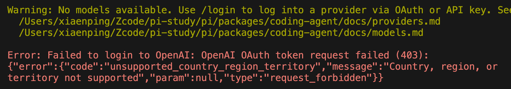

# 运行 Pi 源码（学习第一课）

> 目标：**亲手把 pi/ 里的 Pi 从源码跑起来**，并在每个步骤搞清楚「这条命令到底做了什么」。
> 全程在终端操作。遇到报错先查本文「常见报错排查」，解决不了截图问 AI。
> 本机状态标注（2026-11-16）：标 ✅ 的步骤已在本机成功执行过，你可以**跳过或重跑核对**（都是幂等操作）。

---

## 0. 两种运行方式（先建立全局认知）

Pi 源码仓库提供两种跑法，**学习阶段用方式 A 就够了**：

| 方式 | 命令 | 原理 | 需要构建吗 |
|---|---|---|---|
| A. 源码直跑 | `./pi-test.sh` | Node 直接加载 TypeScript 源码（`--import` 挂 TS 解析器），跳过编译 | **不需要** |
| B. 完整构建 | `npm run build` 后跑产物 | 把 12 个包全部 tsc 编译，打出 `dist/bundle/` | 需要 |

> 学习点：`pi-test.sh` 本质是一行 `node --import <source-resolver.ts> packages/coding-agent/src/cli.ts`。它能直接跑 TS，是因为 Node 22.19+ 的「strip-only type stripping」——TS 类型被原样剥掉而不转译。这也解释了仓库的代码纪律：只允许使用可擦除的 TS 语法（见仓库 AGENTS.md）。

---

## 1. 前置检查

```bash
node -v    # 需要 v22.19 或更高，本机 v24.20.0 ✅
git --version
```

网络提示：本机到 GitHub 时通时断，`git clone` / `npm install` 失败先直接重试。

---

## 2. 获取代码

✅ 本机已完成（克隆到 `~/Zcode/pi-study/pi`，main 分支，浅克隆 `--depth 1`，最新提交 `22fc026`）。

如果你想自己重来一遍（可跳过）：

```bash
cd ~/Zcode/pi-study
git clone --depth 1 https://github.com/wwstudy123/pi.git pi   # 只拉最新提交，快
```

当前学习分支也已检出：

```bash
cd ~/Zcode/pi-study/pi
git branch --show-current    # 应输出 pi-1116-2026
```

> 学习点：`--depth 1` 浅克隆只拉最新快照不下历史，.git 仅 18M。以后要跨分支比 diff 时再按需 `git fetch --depth 1 origin <分支>`。

---

## 3. 安装依赖

✅ 本机已完成（335 个包，约 2 分钟）。

```bash
cd ~/Zcode/pi-study/pi
npm install --ignore-scripts
```

预期输出末尾：`added 335 packages in ~2m`。

> 学习点 1：**为什么 `--ignore-scripts`**？Pi 仓库把 npm 依赖变更当作需要评审的代码变更（供应链安全）。直接依赖全部锁精确版本，`.npmrc` 里 `save-exact=true`，且禁止依赖跑安装期生命周期脚本，防止 npm 包在安装时执行任意代码。
>
> 学习点 2：这是 **npm workspaces monorepo**——根目录一次 `npm install` 会给 12 个 `packages/*` 装依赖，各包通过 `node_modules` 互相以 `@earendil-works/*` 名称引用。

---

## 4. 构建项目

### 4.1 先拉模型数据（构建路径必需，源码直跑可跳过）

✅ 本机已完成。

```bash
npm run hydrate:model-data
```

预期输出：一长串各供应商模型清单（`anthropic: xx chat models...`、`openai: ...`、`zai: 7 chat models...` 等）。

> 学习点：`packages/ai` 构建时会生成模型目录（`models.generated.ts` + `src/providers/data/*.json`），需要从 pi.dev 拉各供应商的模型清单。新克隆的仓库里**没有**这份生成数据（模型数据文件不入 git），所以离线构建第一步 `check:model-data` 会报 `amazon-bedrock.json is not valid JSON: ENOENT`——这就是本机踩过的坑：**先 hydrate，再 build:offline**。

### 4.2 构建

✅ 本机已完成。

```bash
npm run build:offline    # 用刚拉好的模型数据离线构建
# 或 npm run build       # 构建中顺带重新联网刷新模型数据
```

预期输出最后几行：

```
> @earendil-works/pi-coding-agent@1.5.2 build
...
Built packages/coding-agent/dist/bundle (84 files, 9.3 MiB)
```

> 学习点：根 `package.json` 的 `build` 脚本把 12 个包**按依赖拓扑序硬编码**依次 tsc：telemetry → schema → chord → tui → codemode → mcp → ai → durable → env → agent → coding-agent。这个顺序本身就是一张「依赖关系图」。

---

## 5. 验证：第一次跑起来

```bash
cd ~/Zcode/pi-study/pi
./pi-test.sh --version     # 预期输出：1.5.2
./pi-test.sh --help        # 看完整命令与选项
```

---

## 6. 交互模式：真正运行 Pi

### 6.1 建一个实验目录（别在自己的真实项目里瞎玩）

```bash
mkdir -p ~/Zcode/pi-playground && cd ~/Zcode/pi-playground
~/Zcode/pi-study/pi/pi-test.sh
```

`pi-test.sh` 可以在**任何目录**下运行（脚本内部用绝对路径定位源码），Pi 会在当前目录工作。

### 6.2 首次界面

启动后进入 TUI：上方是**转写区**（对话、工具调用与结果），下方是**编辑器**（输入提示词），页脚显示当前目录、会话、模型、上下文用量与累计成本。

### 6.3 连接一个模型供应商（必须做一次）

不连模型无法对话。**国内网络直接选方式 2（API key + 国内供应商）**，不要先试 OpenAI OAuth——会被地域封锁，详见 §7.1 实录案例。三种方式任选：

1. **OAuth 订阅登录**：在 Pi 里输入 `/login`，按提示选供应商（Anthropic / OpenAI / Google Gemini / GitHub Copilot 等）在浏览器完成授权。**OpenAI / Anthropic / Gemini 的 OAuth 从中国大陆 IP 发起会被 403 拒绝**，除非终端走了能落到支持地区的代理。
2. **API key 环境变量**：退出 Pi，`export` 对应变量后再启动。内置供应商都有各自的变量名（见 `packages/coding-agent/docs/providers.md`），国内可直接用的：
   ```bash
   export DEEPSEEK_API_KEY=sk-xxx        # DeepSeek
   export MOONSHOT_API_KEY=sk-xxx        # Kimi/Moonshot
   export KIMI_API_KEY=sk-xxx            # Kimi For Coding
   export ZAI_CODING_CN_API_KEY=xxx      # 智谱 GLM（国内 Coding Plan）
   export MINIMAX_CN_API_KEY=xxx         # MiniMax 国内
   export QWEN_TOKEN_PLAN_INDIVIDUAL_CN_API_KEY=xxx   # 通义千问国内
   ```
3. **任意 OpenAI 兼容端点**：写 `~/.pi/agent/models.json` 声明（Ollama / vLLM / 中转都行），详见 `docs/models-configuration.md`。

> 学习点：凭据解析优先级是 `--api-key` > `auth.json` > `models.json` > 环境变量。`/login` 的凭据落在 `~/.pi/agent/auth.json`。`/login` 也支持纯 API key 供应商——选 DeepSeek 等然后粘贴 key，效果等同环境变量，且会存进 auth.json 下次不用再 export。

### 6.4 发第一条消息

在编辑器里输入一个任务，比如：

```
读一下当前目录里有什么文件，然后创建 hello.txt，内容写"hello from pi"
```

你会看到 Pi 流式输出思考/文本，并依次调用 `ls`/`write` 类工具——每个工具调用都会显示参数和结果。

### 6.5 常用操作速查

| 操作 | 按键 / 命令 |
|---|---|
| 发送 / 中途转向（steering） | Enter |
| 排队消息（follow-up，任务结束后注入） | Alt+Enter |
| 中止当前任务（排队消息退回编辑器） | Escape |
| `@` 引用文件 | 编辑器里输 `@`，Tab 补全 |
| 跑命令且输出进上下文 / 不进上下文 | `!ls -la` / `!!ls -la` |
| 循环切换模型 | Ctrl+P（`/model`、`/scoped-models` 配置） |
| 切思考等级 | Shift+Tab 或 `/thinking` |
| 展开工具输出 / 折叠思考块 | Ctrl+O / Ctrl+T |
| 外部编辑器写长提示词 | Ctrl+G |
| 查看会话统计 | `/session` |
| 会话树 / 分叉 / 克隆 | `/tree` / `/fork` / `/clone` |
| 压缩上下文 | `/compact` |
| 退出 | `/quit` |

### 6.6 观察：它会话存到了哪

```bash
ls ~/.pi/agent/sessions/
```

每个会话是一个 JSONL 文件（按工作目录分组的目录里），首行是 session header，之后每条消息一个 JSON、用 `id`/`parentId` 构成树——这就是后面复刻会话系统时要 1:1 复刻的格式（`docs/session-format.md`）。

---

## 7. 常见报错排查

| 现象 | 原因 | 解决 |
|---|---|---|
| `npm error network` / `ETIMEDOUT`（install 或 clone） | 本机到 GitHub/npm 网络抖动 | 直接重试，多试几次 |
| 构建报 `xxx.json is not valid JSON: ENOENT`（providers/data 下） | 新克隆仓库没有模型数据 | `npm run hydrate:model-data` 后重新 build |
| `pi-test.sh: permission denied` | 脚本无执行位 | `chmod +x pi-test.sh` 或 `bash pi-test.sh` |
| 启动后无法对话、提示无可用供应商 | 没配凭据 | 见 6.3 三种方式 |
| `/login` OpenAI 报 403 `unsupported_country_region_territory` | 中国大陆 IP 被 OpenAI OAuth 拒绝 | 见下方实录案例；换国内供应商 API key 最快 |
| 想验证「无 API key 也能跑」 | 环境里已有 key 干扰 | `./pi-test.sh --no-env`（脚本会 unset 全部 key 环境变量） |
| `engines` 报 Node 版本不符 | Node < 22.19 | 升级 Node |

### 7.1 实录：OpenAI OAuth 403（国内网络）

**现象**（2026-11-16，本机实录）：启动后警告没有可用模型，`/login` 选 OpenAI 后报错：



```
Warning: No models available. Use /login to log into a provider via OAuth or API key.
Error: Failed to login to OpenAI: OpenAI OAuth token request failed (403):
{"error":{"code":"unsupported_country_region_territory","message":"Country, region, or territory not supported","param":null,"type":"request_forbidden"}}
```

**原因**：这不是 Pi 的 bug。OpenAI 的 OAuth token 接口按 IP 归属地拦截中国大陆等不支持地区的请求，返回 403 `unsupported_country_region_territory`。前面的 `Warning: No models available` 只是因为还没配任何凭据，属正常提示。

**解决（按推荐顺序）**：

1. **换国内供应商 + API key（推荐，学习最顺）**：去 DeepSeek / Moonshot Kimi / 智谱开放平台任一家申请 key，然后：
   ```bash
   export DEEPSEEK_API_KEY=sk-xxx
   cd ~/Zcode/pi-playground
   ~/Zcode/pi-study/pi/pi-test.sh
   # 进去后 /model 选 deepseek 模型即可对话
   ```
   也可以不 export，直接在 Pi 里 `/login deepseek` 粘贴 key（存 auth.json，一劳永逸）。
2. **坚持用 OpenAI OAuth**：让终端流量从支持地区出去（全局/TUN 模式代理），再 `/login openai` 重试。只设 `HTTPS_PROXY` 不一定生效——Node 的 fetch 不一定读这个变量，不行就用方案 1。
3. **OpenAI 官方 API key + 兼容端点/中转**：有 key 但网络不通时，用 `models.json` 指向可达的 OpenAI 兼容地址，不要走 OAuth。

**验证是否配好**：重启 Pi 后页脚应显示模型名，或输入 `/model` 能看到可选模型列表；`/session` 能看到 provider。

---

## 8. 自检清单（跑完这课你应该能回答）

- [ ] `pi-test.sh` 为什么不用构建就能跑？（提示：Node type stripping + `--import` 解析器）
- [ ] `npm install` 为什么要加 `--ignore-scripts`？这体现了仓库什么安全立场？
- [ ] 构建顺序为什么是 telemetry → schema → … → coding-agent？画一下依赖图。
- [ ] `hydrate:model-data` 在补什么数据？为什么它不入 git？
- [ ] Pi 的会话文件在哪个目录？打开一个 JSONL 看看 header 长什么样。
- [ ] `/login` 之后凭据存到了哪个文件？

---

## 9. 下一步

- 第二课预告：**读代码——agent loop**。从 `packages/agent/src/agent.ts` 入手，对照 `docs/how-pi-works.md`，搞清「一条消息进来之后发生了什么」。
- 复刻路线总纲见 [功能地图](./feature-map.md)。
